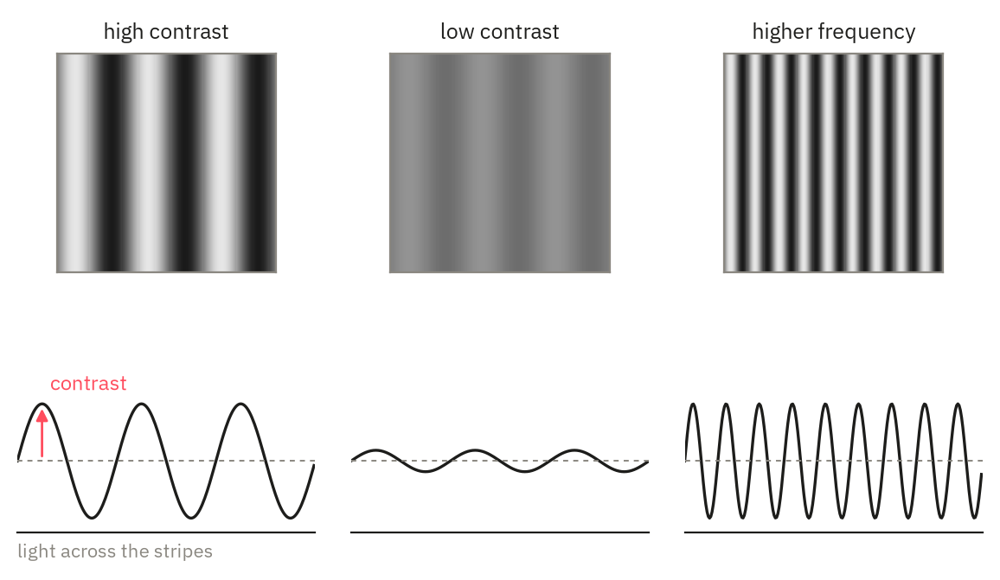
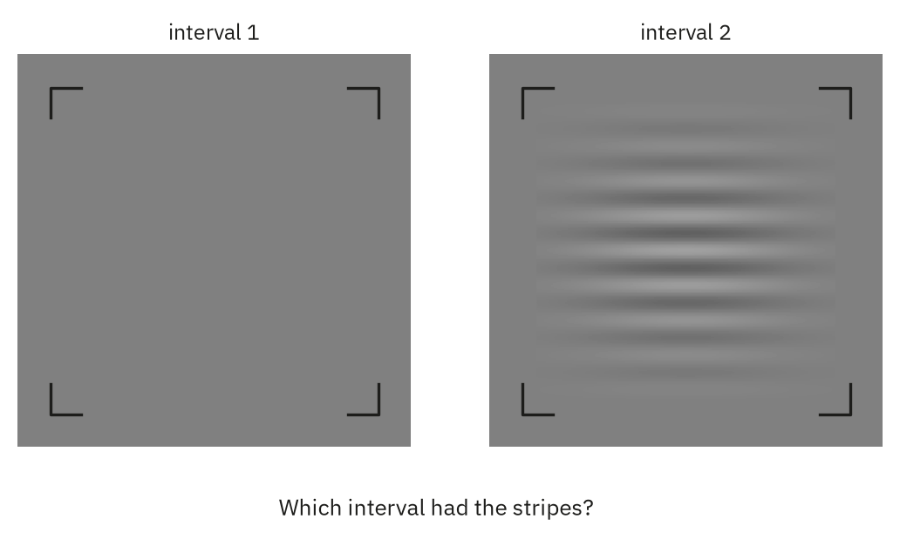
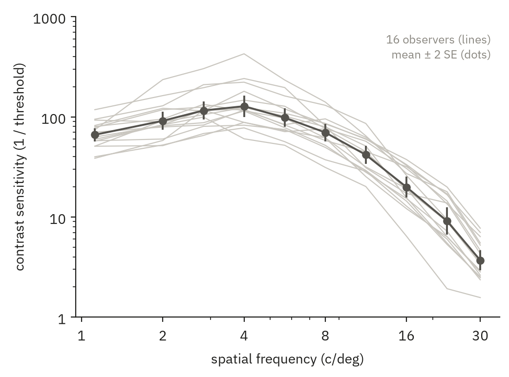
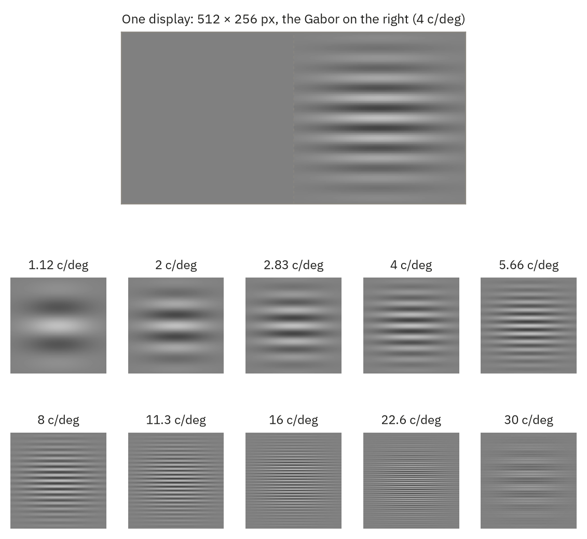
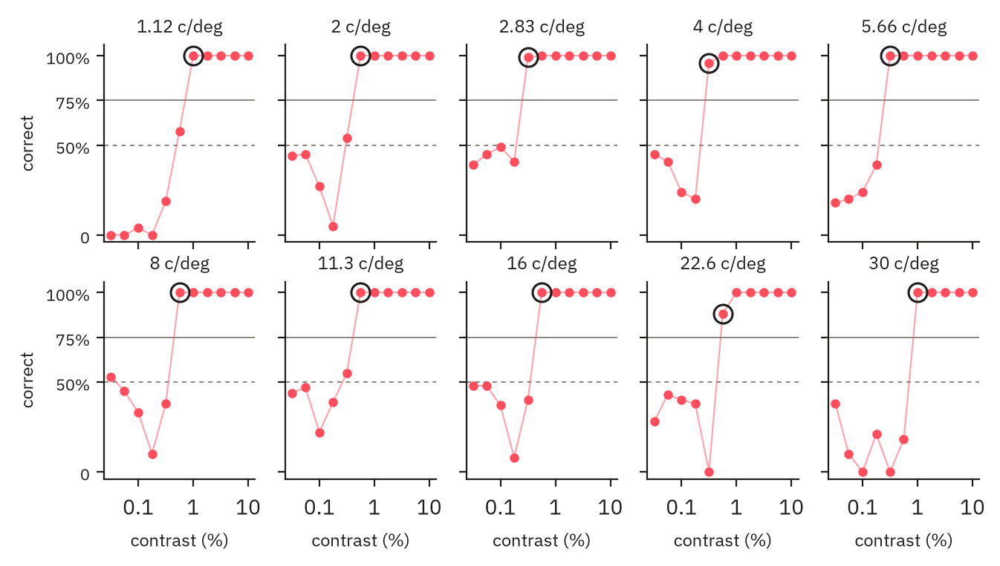
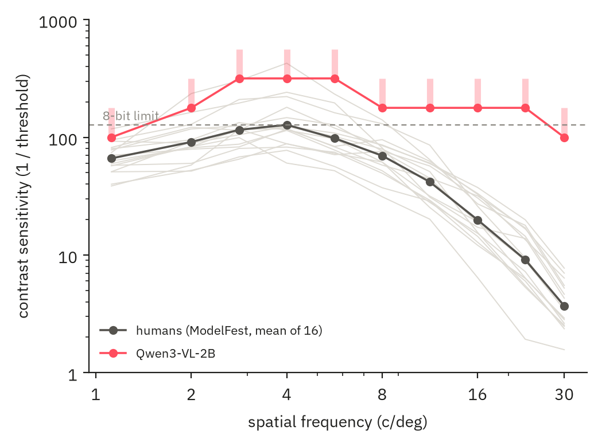

# Contrast sensitivity

### What we will do here

1. What contrast sensitivity is, and the curve it makes over spatial frequency.
2. The original experiment: Campbell & Robson (1968), and human data from ModelFest.
3. The same task for a vision-language model.
4. What happens to faint stripes inside the model, with its real numbers.
5. What the model did.
6. The model next to the human observers.
7. What it means.

### What is contrast sensitivity?

Contrast sensitivity is how well we see a pattern that differs only a little from its background. The usual pattern is a grating: stripes whose brightness changes like a sine wave.

**Figure 1.** Gratings with high and low contrast, and with a higher spatial frequency. Below each, the light across the stripes. Contrast is how far the light goes above and below the mean (red arrow). Spatial frequency is the number of stripes (cycles) per degree of visual angle (c/deg).

The lowest contrast at which a grating is still visible is the contrast threshold. Contrast sensitivity is 1 / threshold.

## Seeing stripes: the contrast sensitivity function | The sensitivity curve

Contrast sensitivity is not the same for all stripe widths. Plotted against spatial frequency, it gives the contrast sensitivity function (CSF; Campbell & Robson, 1968). Middle frequencies are seen best; very wide and very fine stripes need more contrast.

**Figure 2.** The stripes get finer to the right and fainter to the top. The height where they fade into grey follows your own CSF, highest in the middle. The exact frequencies depend on your viewing distance.

## The original experiment: Campbell & Robson (1968) | The original experiment

Campbell and Robson asked if the CSF can predict how visible any striped pattern is, not only sine waves. They measured contrast thresholds for sine waves and for other patterns (e.g. square waves) at many spatial frequencies; the observer set the contrast until the stripes were just visible.

For sine waves, sensitivity was highest at 4 c/deg and fell on both sides. A square wave was seen once its main sine component reached its own threshold. Their explanation: the visual system has separate channels, each tuned to a narrow range of spatial frequencies.

### The human data we use: ModelFest

Campbell and Robson's data exist only as points in printed figures. For numbers we use ModelFest (Watson & Ahumada, 2005): contrast thresholds of 16 observers from 10 labs, all measured on the same images, in a public data file.

### Stimuli and the task

ModelFest stimuli 1 to 10 are Gabors: gratings under a round Gaussian window (standard deviation 0.5°), at 10 frequencies from 1.12 to 30 c/deg. Each image was 256 × 256 pixels at 120 pixels per degree (2.133°), at a mean luminance of 30 ± 5 cd/m², seen with both eyes. Each presentation faded in and out (a Gaussian time course, standard deviation 0.125 s).

**Figure 3.** A ModelFest trial, drawn from the paper's description (4 c/deg; contrast raised so it is visible here). The Gabor is in one of two intervals, with marks at the corners to help fixation. The observer says which interval had the stripes (two-interval forced choice).

Each threshold came from at least 32 trials with feedback, and was measured at least four times. The labs differed in some details of the procedure, and the paper does not give the percent correct at which the threshold was taken.

### Human results

The ModelFest curve has the same shape as Campbell and Robson's. Sensitivity is highest at about 4 c/deg, where the mean threshold is 0.78% contrast (sensitivity 128), and falls towards both ends (Watson & Ahumada, 2005).

**Figure 4.** Contrast sensitivity for ModelFest stimuli 1 to 10. Thin lines: the 16 observers (mean of four thresholds each). Dots: the mean over observers, ± 2 SE. Data: Watson & Ahumada (2005).

# Contrast sensitivity in Vision Language Models

## Doing it with a VLM | The experiment

We show Qwen3-VL-2B the ModelFest Gabors at the same size in pixels: 120 pixels per degree, each field 256 × 256 pixels. The two intervals become the two halves of one image (512 × 256 pixels), with the Gabor in one half. The question is: "Where is the striped pattern: left or right? Answer with one word."

There are 10 frequencies (1.12 to 30 c/deg) and 11 contrasts (0.03% to 10%), with 100 trials each and a random phase of the stripes in every trial.

**Figure 5.** Top: one display as the model gets it (4 c/deg, Gabor on the right). Below: the ten ModelFest Gabors. Both at 50% contrast so they are easy to see here.

### What had to change

1. **No 8-bit images.** In an ordinary image the smallest step in grey is a contrast of 0.79%, about the human threshold at 4 c/deg. So the model gets the exact grey values instead: the same numbers its image processor would make, without rounding. How an image becomes numbers for the model is shown in the crowding chapter (Figure 6).
2. **The model prefers "left".** Even with the stripes on the right, it often says left. So every trial shows the same Gabor twice, once on each side. For each display we read how much more the model wants to say "left" than "right" as its first word. The trial is correct if that is higher when the Gabor is on the left. Like the human task, it compares two displays.

### Does the model see more than it says?

The model's answer is one word, left or right. Before that word, the image passes through the vision part (24 layers), the merger and the language model (28 layers); at each layer it is a list of numbers (crowding chapter, Figure 6). Here we follow a faint Gabor through these layers, with the model's real numbers.

**1. A Gabor too faint to see.** We take a 4 c/deg Gabor at 0.1% contrast, where the model's answer is usually wrong. That is eight times below the human threshold, and less than one grey step of a screen; the model gets the exact values.

**Figure 6a.** Our Gabor fades from 50% to 0.1% contrast.

**2. One square, two runs.** We run the model twice on the same display: once with the 0.1% Gabor, once without it. Then we compare the two runs, square by square. If the model did not register the Gabor at all, the two runs would give the same numbers.

**Figure 6b.** One square in the middle of the Gabor, after vision layer 1: its 1,024 numbers in both runs, and their difference. The difference is 0.15% of the size of the numbers; that sets the square's colour in the next two figures. Real values from Qwen3-VL-2B.

**3. Through the vision part.** Now every square, layer by layer. In the first layers only the squares of the Gabor differ. Each layer mixes the squares (crowding chapter, Figure 6c), so the difference spreads to the half with no Gabor, even though its pixels are the same in both runs. By layer 24 the average difference in the Gabor's half is 13%, about 300 times more than after layer 1.

**Figure 6c.** Each square coloured by how different its numbers are with and without the 0.1% Gabor, in vision layers 1 to 24 and the merger. Left: the half with the Gabor; right: the half with no Gabor.

**4. Through the language model.** The image tokens keep the difference in all 28 layers. At the place where the answer is written it is small (0.1 to 0.6%), but never zero.

**Figure 6d.** The same in the language model: the image tokens of each half, and on the right the place where the answer is written.

**5. A read-out at every layer.** Is that enough to find the stripes? At each layer we train a simple read-out (a logistic regression) to say "left" or "right" from the layer's numbers, on 80 pairs of displays, and test it on 20 others. It is scored like the model's answer.

**Figure 6e.** The model from image to answer, with a read-out at every layer (red).

**Figure 6f.** The read-out at each layer against the model's own answer, at each contrast.

*Results to come from run_layers.ipynb. In a small test (10 pairs), the read-out found the stripes at every layer at 0.1% contrast, while the answer was right in 2 of the 10 pairs.*

The model has no noise: the same image always gives exactly the same numbers. In humans, neurons are noisy, and that noise sets the threshold. In the model, any change, however small, is there to be read.

**6. The answer.** So why is the answer wrong? Part of it is a habit of the language model. With no Gabor, the model says "left" 77% of the time; with no image at all, 80%. If the question says "right or left", only 42%: it prefers the word that comes first.

**Figure 6g.** How often the model would say "left" (out of left and right), for a 4 c/deg Gabor on the left and on the right, as the contrast rises. Dashed line: no Gabor. Real values, for one phase of the stripes.

Faint stripes move the answer by about one percent, sometimes the wrong way. From about 0.3% contrast, the answer follows the stripes.

## What the model did

The model got every Gabor right from 1% contrast up, at all ten frequencies. Below that it did not get worse slowly, as a human would: within one step of contrast it went from 100% correct to guessing, or worse.

**Figure 7.** Proportion correct for each frequency and contrast, 100 trials per point. Dashed line: guessing (50%). Circled: the threshold, the faintest contrast with at least 75% correct.

We take the threshold as the faintest contrast with at least 75% correct; the true threshold lies between that contrast and the one below it. The model's thresholds are 0.3% to 1% contrast. Eight of the ten are below one grey step of an ordinary image (0.79%), so with 8-bit images we could not have measured them.

Below threshold the model is often right less than half of the time. The faint stripes push its answer a little towards the wrong side (Figure 6g), and they do so for most phases of the stripes.

## Model versus humans

**Figure 8.** Contrast sensitivity (1 / threshold) of Qwen3-VL-2B (red) and the 16 ModelFest observers (grey lines; dark grey: their mean). The model's true sensitivity lies within the pale bar. Dashed line: the most an 8-bit image could show.

### Like humans

1. **A curve with a top.** The model is most sensitive at 2.83 to 5.66 c/deg, around the human peak of 4 c/deg, and less at both ends.

### Unlike humans

1. **Far more sensitive.** About 2.5 times more sensitive than the human mean at 4 c/deg, and 25 times or more at 30 c/deg.
2. **Fine stripes are not lost.** From 4 to 30 c/deg, human sensitivity falls by a factor of about 30; the model's falls by about 3.
3. **A step, not a curve.** Human psychometric functions rise gradually, because neurons are noisy. The model has no noise: the same image always gives the same answer, so it jumps from guessing to 100%.
4. **Wrong, not guessing.** Below threshold the model is often wrong more than half of the time; a human observer would be at chance.

ModelFest does not say at what percent correct its thresholds were taken. For the model this hardly matters: any cutoff from 60% to 85% gives the same thresholds, and 90% moves one of them by one step.

## What it means

*To be written.*
