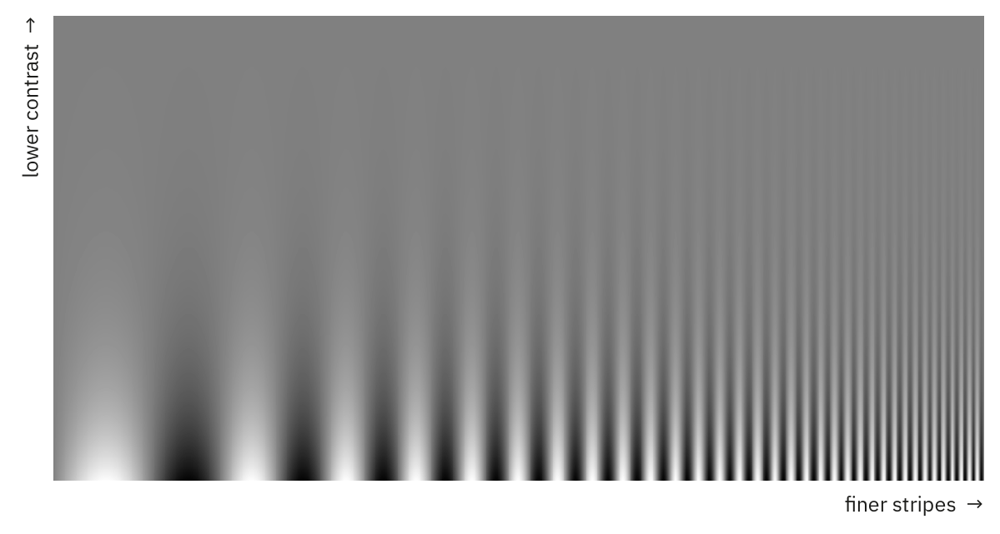
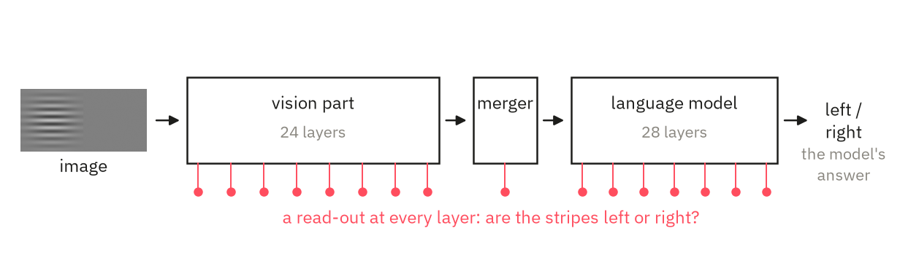
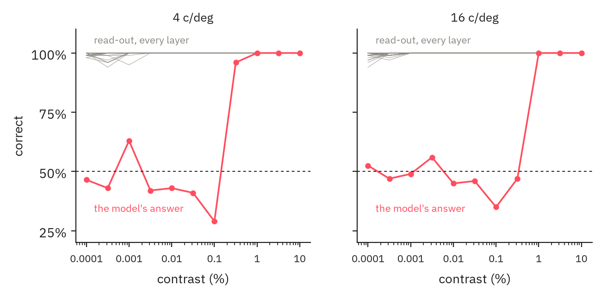
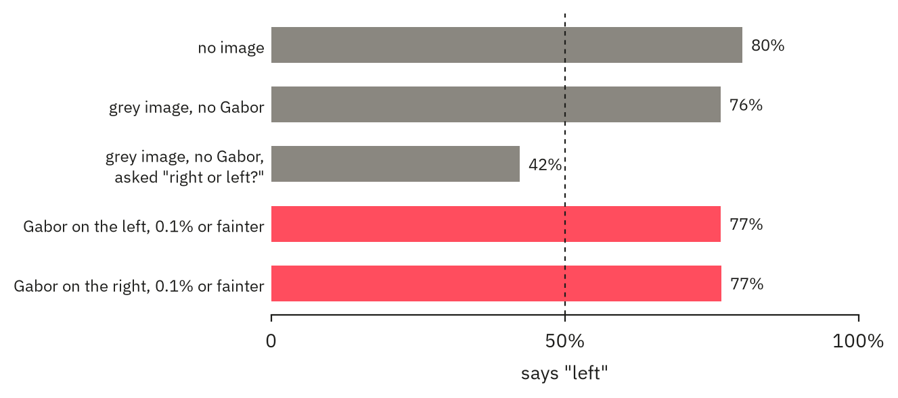

# Contrast sensitivity

### What we will do here

1. What contrast sensitivity is, and the curve it makes over spatial frequency.
2. The original experiment: Campbell & Robson (1968), and human data from ModelFest.
3. The same task for a vision-language model.
4. What happens to faint stripes inside the model, with its real numbers.
5. What the model did.
6. The model next to the human observers.
7. A habit of the model: it prefers the word "left".
8. What it means.

### What is contrast sensitivity?

Contrast sensitivity is how well we see a pattern that differs only a little from its background. The usual pattern is a grating (stripes whose brightness changes like a sine wave).

**Figure 1.** Gratings with high and low contrast, and with a higher spatial frequency. Below each, the light across the stripes. Contrast is how far the light goes above and below the mean (red arrow). Spatial frequency is the number of stripes (cycles) per degree of visual angle (c/deg).

The lowest contrast at which a grating is still visible is the contrast threshold. Contrast sensitivity is 1 / threshold.

## Seeing stripes: the contrast sensitivity function | The sensitivity curve

Contrast sensitivity is not the same for all stripe widths. Plotted against spatial frequency, it gives the contrast sensitivity function (CSF; Campbell & Robson, 1968). Middle frequencies are seen best; very wide and very fine stripes need more contrast.

**Figure 2.** The stripes get finer to the right and fainter to the top. The height where they fade into grey follows your own CSF, highest in the middle. The exact frequencies depend on your viewing distance.

## The original experiment: Campbell & Robson (1968) | The original experiment

Campbell and Robson asked if the CSF can predict how visible any striped pattern is, not only sine waves. They measured contrast thresholds for sine waves and for other patterns (e.g. square waves) at many spatial frequencies; the observer set the contrast until the stripes were just visible.

For sine waves, sensitivity was highest at 4 c/deg and fell on both sides. A square wave was seen once its main sine component reached its own threshold. They explained this with separate channels in the visual system, each tuned to a narrow range of spatial frequencies.

### The human data we use: ModelFest

Campbell and Robson's data exist only as points in printed figures. For numbers we use ModelFest (Watson & Ahumada, 2005). It has the contrast thresholds of 16 observers from 10 labs, all measured on the same images, in a public data file.

### Stimuli and the task

ModelFest stimuli 1 to 10 are Gabors (gratings under a round Gaussian window, standard deviation 0.5°), at 10 frequencies from 1.12 to 30 c/deg. Each image was 256 × 256 pixels at 120 pixels per degree (2.133°), at a mean luminance of 30 ± 5 cd/m², seen with both eyes. Each presentation faded in and out (a Gaussian time course, standard deviation 0.125 s).

**Figure 3.** A ModelFest trial, drawn from the paper's description (4 c/deg; contrast raised so it is visible here). The Gabor is in one of two intervals, with marks at the corners to help fixation. The observer says which interval had the stripes (two-interval forced choice).

Each threshold came from at least 32 trials with feedback, and was measured at least four times. The labs differed in some details of the procedure, and the paper does not give the percent correct at which the threshold was taken.

### Human results

The ModelFest curve has the same shape as Campbell and Robson's. Sensitivity is highest at about 4 c/deg, where the mean threshold is 0.78% contrast (sensitivity 128), and falls towards both ends (Watson & Ahumada, 2005).

**Figure 4.** Contrast sensitivity for ModelFest stimuli 1 to 10. Thin lines: the 16 observers (mean of four thresholds each). Dots: the mean over observers, ± 2 SE. Data: Watson & Ahumada (2005).

# Contrast sensitivity in Vision Language Models

## Doing it with a VLM | The experiment

Hernández-Cámara et al. (2025) measured CSFs in several vision-language models with filtered noise and a yes/no question. Here we stay closer to the human experiment, so the model can be compared with the human data directly.

We show Qwen3-VL-2B the ModelFest Gabors at the same size in pixels (120 pixels per degree). The two intervals become the two halves of one image, with the Gabor in one half. The question is "Where is the striped pattern: left or right? Answer with one word." There are 10 frequencies and 11 contrasts (0.03% to 10%), with 100 trials each.

Each trial has two displays with the same Gabor, once on the left and once on the right. For each display we read how much the model leans to "left" over "right". The trial is correct if the lean is bigger when the Gabor is on the left.

**Figure 5.** Top: one display as the model gets it (4 c/deg, Gabor on the right). Below: the ten ModelFest Gabors. Both at 50% contrast so they are easy to see here.

### What had to change

**No 8-bit images.** An image file stores grey as whole numbers from 0 to 255. On our grey of 128, one step is already 0.79% contrast, about the human threshold at 4 c/deg. So we give the model the grey values with decimals, without rounding. How an image becomes numbers for the model is shown in the crowding chapter (Figure 6).

### A faint Gabor inside the model

Before the one-word answer, the image passes through the vision part (24 layers), the merger and the language model (28 layers). Here we follow a faint Gabor through these layers, with the model's real numbers.

**1. A faint Gabor.** A 4 c/deg Gabor at 0.1% contrast, eight times below the human threshold. Here the model's answer is usually wrong.

**Figure 6a.** Our Gabor fades from 50% to 0.1% contrast.

**2. One square, two runs.** We run the model twice, once with the Gabor and once without it, and compare the numbers of each square. If the model ignored the Gabor, the two runs would be the same.

**Figure 6b.** One square in the middle of the Gabor, after vision layer 1: its 1,024 numbers in both runs, and their difference. The size of the difference sets the square's colour in the next two figures. Real values from Qwen3-VL-2B.

**3. Through the vision part.** At first only the squares of the Gabor differ. Each layer mixes the squares, so the difference spreads to the half with no Gabor. By layer 24 it is about 300 times bigger than after layer 1.

**Figure 6c.** Each square coloured by how different its numbers are with and without the 0.1% Gabor, in vision layers 1 to 24 and the merger.

**4. Through the language model.** The difference stays in all 28 layers, and reaches the place where the answer is written.

**Figure 6d.** The same in the language model. On the right, the place where the answer is written.

**5. A read-out at every layer.** At each layer we train a simple read-out (a logistic regression) to say "left" or "right" from the layer's numbers.

**Figure 6e.** The model from image to answer, with a read-out at every layer (red).

**Figure 6f.** Proportion correct of the read-out at every layer (grey, one line per layer) and of the model's own answer (red), 100 pairs per point. Dashed line: guessing (50%).

The read-out finds the stripes at every layer, even at 0.0001% contrast. The model's answer needs 0.3% (4 c/deg) or 1% (16 c/deg). So the stripes are there, but the answer does not use them. The model has no noise, so even a very small change in the image changes its numbers. In humans, noise in the neurons sets the threshold.

## What the model did

The model got every Gabor right from 1% contrast up, at all ten frequencies. Below 1% it did not get worse slowly, as a human does. Within one step of contrast it dropped from 100% correct to guessing, or below.

**Figure 7.** Proportion correct for each frequency and contrast, 100 trials per point. Dashed line: guessing (50%). Circled: the threshold.

We take the threshold as the faintest contrast with at least 75% correct; the true threshold lies between that contrast and the one below it. The model's thresholds are 0.3% to 1% contrast. Eight of the ten are below one grey step of an ordinary image (0.79%), so with 8-bit images we could not have measured them.

## Model versus humans

**Figure 8.** Contrast sensitivity (1 / threshold) of Qwen3-VL-2B (red) and the 16 ModelFest observers (grey lines; dark grey: their mean). The model's true sensitivity lies within the pale bar. Dashed line: the most an 8-bit image could show.

### Like humans

1. **A curve with a top.** The model is most sensitive at 2.83 to 5.66 c/deg, around the human peak of 4 c/deg, and less at both ends.

### Unlike humans

1. **Far more sensitive.** About 2.5 times more sensitive than the human mean at 4 c/deg, and 25 times or more at 30 c/deg.
2. **Fine stripes are not lost.** From 4 to 30 c/deg, human sensitivity falls by a factor of about 30; the model's falls by about 3.
3. **A sudden jump.** Human psychometric functions rise gradually, because neurons are noisy. The model has no noise. The same image always gives the same answer, so it jumps from guessing to 100%.
4. **Below chance.** Below threshold the model is often wrong more than half of the time, because faint stripes push its answer a little the wrong way. A human observer would be at chance.

ModelFest does not say at what percent correct its thresholds were taken. For the model this hardly matters. Any cutoff from 60% to 85% gives the same thresholds, and 90% moves one of them by one step.

### A habit of the model: it prefers "left"

With no Gabor at all, the model still says "left" 76% of the time, and with no image at all 80%. When the question asks "right or left?" instead of "left or right?", it says "left" only 42% of the time. So it partly prefers the word that comes first in the question. We measured this after the main run.

**Figure 9.** How often the model would say "left" (out of left and right). Grey: no Gabor. Red: the main run, for Gabors of 0.1% contrast or fainter, on each side. Dashed line: no preference.

Faint Gabors do not change this habit. In the main run, at 0.1% or fainter, the first word would be "left" for all 6,000 displays (3,000 trials), whichever side the Gabor was on. Scored one display at a time, that gives exactly 50%, like guessing. This is why each trial compares two displays. The habit adds the same lean to both, so only the stripes make a difference.

## What it means

The model's curve has a top near the human one, but it sees much fainter stripes and keeps the fine ones. Hernández-Cámara et al. (2025) found that models match the human CSF in shape or in level, but not both. Ours matches the shape.

Humans lose fine stripes because the eye blurs them and the signal is noisy. The model gets exact pixels, with no blur and no noise. Small networks trained to remove eye blur and cone noise do develop human-like CSFs (Li et al., 2022).

The model's threshold comes from its answer. Its layers carry the stripes at far lower contrasts. The answer also carries habits of language, like the preference for "left". So testing a VLM measures its vision and its language together.

### References

- Campbell, F. W., & Robson, J. G. (1968). Application of Fourier analysis to the visibility of gratings. *Journal of Physiology*, 197, 551–566.
- Hernández-Cámara, P., Gomez-Villa, A., Jaén-Lorites, J. M., Vila-Tomás, J., Laparra, V., & Malo, J. (2025). Contrast sensitivity in multimodal large language models: A psychophysics-inspired evaluation. *arXiv*:2508.10367.
- Li, Q., Gomez-Villa, A., Bertalmío, M., & Malo, J. (2022). Contrast sensitivity functions in autoencoders. *Journal of Vision*. *arXiv*:2103.00481.
- Watson, A. B., & Ahumada, A. J., Jr. (2005). A standard model for foveal detection of spatial contrast. *Journal of Vision*, 5(9):6, 717–740.
