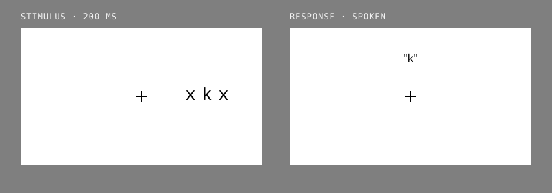
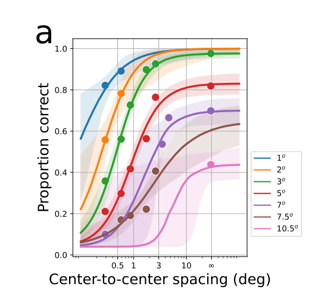
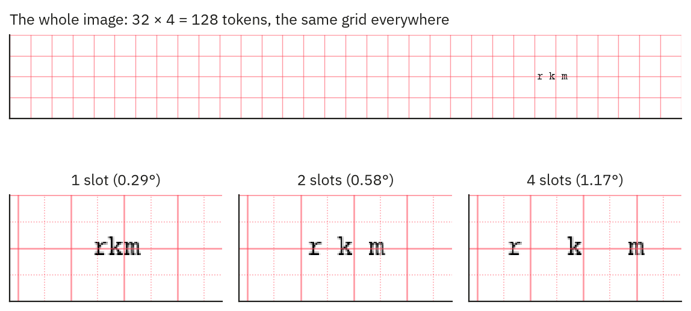

# Crowding

### What we will do here

1. What crowding is, and Bouma's simple spacing rule for it.
2. The original experiment: Bouma (1970) and his data.
3. The same task for a vision-language model.
4. What the model did.
5. The model next to Bouma's observers.
6. What it means.

### What is crowding?

An object (target) you can read when its isolated becomes very difficult to discriminate when surrounded by neighboring objects (flankers).  

**Figure 1.** Look at the cross. The N on the left is easy to name; the same N on the right, at the same distance, is lost between D and O.

## A surprisingly simple spacing rule: Bouma's window

Flankers hurt when they are closer than about half the eccentricity: Bouma's law. The critical spacing grows in a straight line with distance from fixation.

[demo: bouma]

**Figure 2.** Keep your eyes on the cross and move the slider. With the flankers close, the middle letter is hard to name; past about half the eccentricity (Bouma's window), it becomes easy. Click the image for new letters.

## The original experiment: Bouma (1970)

Here we use Bouma's own data from 1970, refitted with modern psychometric functions by Coates and colleagues (2021).

### Stimuli and the task

**Figure 3.** An example trial, drawn after Bouma (1970). The observer says the middle letter aloud.

Bouma's observer named the letter out loud. We ask the model the same question, "What was the middle letter?", but it must pick one of the 25 letters, even when guessing (a forced choice).

### Psychometric function fitting

Bouma tested each spacing about 100 times, at distances from 1° to 10.5° from fixation. Accuracy rises with spacing along an S-shaped curve, one curve per distance. The critical spacing is where a curve gets close to the accuracy for a letter on its own.

**Figure 4.** Bouma's data (dots) with fitted psychometric functions, one colour per distance from fixation. The further from fixation, the further right the curve: the letters must be further apart to be read. From Coates et al. (2021).

# Crowding in Vision Language Models

## Doing it with a VLM | The experiment

A VLM sees the whole image at the same resolution, so it may not crowd at all. We test this with one simple version of Bouma's experiment.

### The observer

The observer is Qwen3-VL-2B-Instruct, a small open vision-language model. It gets one image and one question and answers with text. We do not let it write freely. We read the score it gives to each of the 25 letters as its first word and take the highest one. So, like Bouma's observer, it always answers with a letter, and guessing gives 1 in 25 correct.

### The images

**Figure 5.** The images the model sees. Top: two whole images, with the target at the centre (0°) and at 10°. Bottom: the six conditions, cut around the target.

**Letters.** Lowercase Courier at Bouma's size: the x-height is 13.4 arcmin and one letter slot is 0.29°.

**Pixels.** Bouma typed his letters on paper, but a model needs pixels. We draw the display as a 24-inch, 1920-pixel monitor would show it from Bouma's 50 cm: about 32 pixels per degree. A small letter is then 7 pixels tall.

**Position.** The image is 1024 × 128 pixels (32° × 4°). Its centre plays the role of fixation. The target is at the centre (0°) or 10° to the right.

**Flankers.** One letter on each side of the target, 1, 2, 4, 8 or 16 slots away, centre to centre (0.29° to 4.7°). Or no flankers at all.

**Trials.** Each of the 25 letters four times per condition: 100 trials per point, as in Bouma's experiment. 1,200 trials in all.

The flankers are random letters, not Bouma's "x". In a first run with "x" flankers the model was almost never wrong, at any spacing. Random letters from the same set as the target are also what most later studies use (Pelli et al., 2004).

### The question

The same question for every image: "There is either one letter or a row of three letters. If there are three, name the middle one. If there is one, name it. Answer with a single lowercase letter."

### How the model sees the image

The model does not see letters. First it cuts the image into small squares of 16 × 16 pixels, about half a degree here. Each square becomes a list of numbers that describes what is in it: a stroke here, a curve there. Then these descriptions are mixed with each other, so each square can use what the others contain. Last, every block of 2 × 2 squares is packed into one token, the unit that the language part of the model reads. Our image becomes 32 × 4 = 128 tokens.

**Figure 6.** The model's grid on our images. Top: the whole image in tokens (red). Bottom: close-ups at 10°, with the tokens and the 16-pixel squares inside them (dotted). When the flankers touch the target, some squares hold parts of two letters.

This is very different from an eye. Human vision is sharp only at the centre, and the area over which features are pooled grows with distance from fixation. That growing area is a common explanation for Bouma's rule (Balas et al., 2009). The model has none of this: the grid is the same at 10° as at the centre. So if crowding only came from pooling that grows with distance, the model should crowd the same at 0° and at 10°.

### What is different from Bouma

**No time limit.** Bouma showed each line for 200 ms. The model sees the image once, for as long as it needs.

**No fixation.** The model sees the whole image at once. Here eccentricity only means distance from the centre of the image.

**No "illegible".** Bouma's observer could say he could not read the letter. The model must choose.

**Different flankers and positions.** Random letters instead of "x", and only two positions: 0° and 10°.

### What we want to find out

1. Do close flankers make the model wrong?
2. Is the model worse at 10° than at 0°, as humans are?
3. When it is wrong, does it name a flanker?

## What the model did

**Figure 7.** Proportion correct against target–flanker spacing. Each model point is 100 trials. In grey, Bouma's own data at the two eccentricities closest to ours, 1° and 7°, with "x" flankers. He did not test flanked letters at 0° or 10°.

A letter on its own was never a problem. The model named it correctly in all 100 trials, both at the centre and at 10°.

Flankers changed that, but only when they were close. At the centre, the model was wrong in 43 of 100 trials when the flankers touched the target (0.29°). From 0.58° on, it was almost always right. At 10° the drop was bigger and reached further: 21% correct at 0.29°, 68% at 0.58° and 92% at 1.17°. Only at 4.7° was it back to 100%.

So the model is worse at 10° than at the centre, as humans are. Fitting the same S-shaped curve as for Bouma's data gives a critical spacing of 0.3–0.4° at the centre and 0.6–1.1° at 10°. The range comes from the cutoff: 60% or 90% of the way from guessing to the letter on its own.

When the model was wrong, it named one of the flankers, in all 169 wrong answers. It was nearly always the flanker on the right: 119 of 123 times at 10°, and 39 of 46 times at the centre.

## Model versus humans

Some of what the model does looks like human crowding.

**Close flankers hurt, more so away from the centre.** This is the basic finding of Bouma (1970).

**Wrong answers are flankers.** Crowded human observers also often report a flanker instead of the target (Strasburger et al., 1991).

**The outer flanker does the damage.** Bouma noticed the same in a pilot: the interference was stronger when the "x" was on the side away from fixation (Bouma, 1970). But the model also preferred the right flanker at the centre, where there is no inner or outer side. Our target was always to the right, so here we cannot tell "outer" from "right".

The human data also has things the model does not.

**Acuity falls with eccentricity.** Bouma's observer read a letter on its own 98% of the time at 3°, 82% at 5°, 70% at 7° and 44% at 10.5°. The model read every letter on its own, at 0° and at 10°.

**Bouma's window is much larger.** In our refit of Bouma's data, the critical spacing at 7° is 1.8° to 5.8° depending on the cutoff, or 0.26 to 0.83 times the eccentricity. The model at 10°, further out, needs only 0.6° to 1.1°: 0.06 to 0.11 times the eccentricity. That is about the size of a human's window at 2° to 3° (0.34° to 1.81° in Bouma's data).

**The window does not follow the grid.** At the centre, the flankers only hurt when they were closer than about 0.3–0.4°, less than one 16-pixel square. There, a flanker hurts mostly when it touches the target and shares squares with it. At 10° the window is 0.6–1.1°, one or two squares, although the grid is exactly the same there. In a side test, we also moved the letters so that a token edge cut the target in half, or so that the target sat in the middle of a token. Accuracy changed by at most 5 points. So the grid alone does not explain the model's window.

**The flankers were harder for the model.** Bouma used "x", the model got random letters. Flankers that look like the target crowd humans more (see Coates et al., 2021, for a review). So with random letters, Bouma's window would likely be even larger, not smaller.

## What it means

The model crowds, but only a little. It shows some of the human signs: close flankers hurt, the wrong answer is a flanker, and it gets worse away from the centre. But its window is several times smaller than a human's at the same place, and a single letter is never lost.

We do not know yet why the model is worse at 10° than at the centre. Its grid is the same everywhere, so it is not about sharpness. In an earlier test, with the target between 2° and 7°, we saw no change with distance. So the centre of the image may be special to the model, rather than distance itself.

Two next steps. First, more positions on both sides of the centre. This would show whether the window really grows with distance, and would separate "outer" from "right". Second, give the model a human-like periphery before it sees the image (Deza et al., 2019), and see if its window grows to Bouma's size.

### References

- Balas, B., Nakano, L., & Rosenholtz, R. (2009). A summary-statistic representation in peripheral vision explains visual crowding. *Journal of Vision*, 9(12):13, 1–18.
- Bouma, H. (1970). Interaction effects in parafoveal letter recognition. *Nature*, 226, 177–178.
- Coates, D. R., Ludowici, C. J. H., & Chung, S. T. L. (2021). The generality of the critical spacing for crowded optotypes: From Bouma to the 21st century. *Journal of Vision*, 21(11):18, 1–22.
- Deza, A., Jonnalagadda, A., & Eckstein, M. P. (2019). Towards metamerism via foveated style transfer. *ICLR*.
- Pelli, D. G., Palomares, M., & Majaj, N. J. (2004). Crowding is unlike ordinary masking: Distinguishing feature integration from detection. *Journal of Vision*, 4(12), 1136–1169.
- Strasburger, H., Harvey, L. O., Jr., & Rentschler, I. (1991). Contrast thresholds for identification of numeric characters in direct and eccentric view. *Perception & Psychophysics*, 49(6), 495–508.
