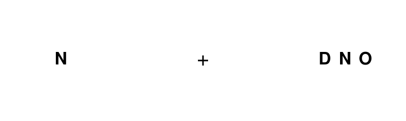
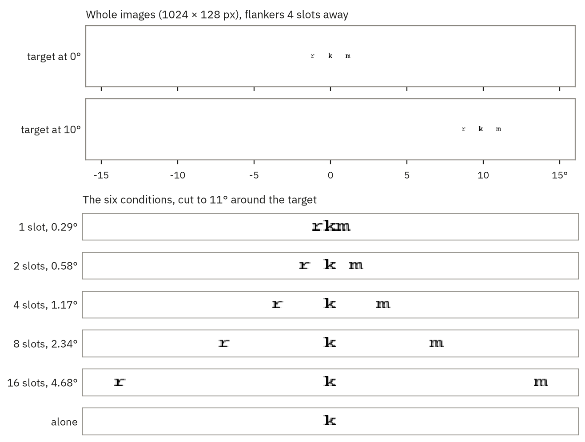
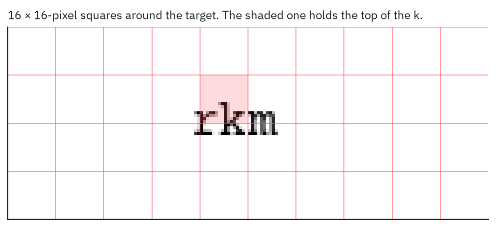
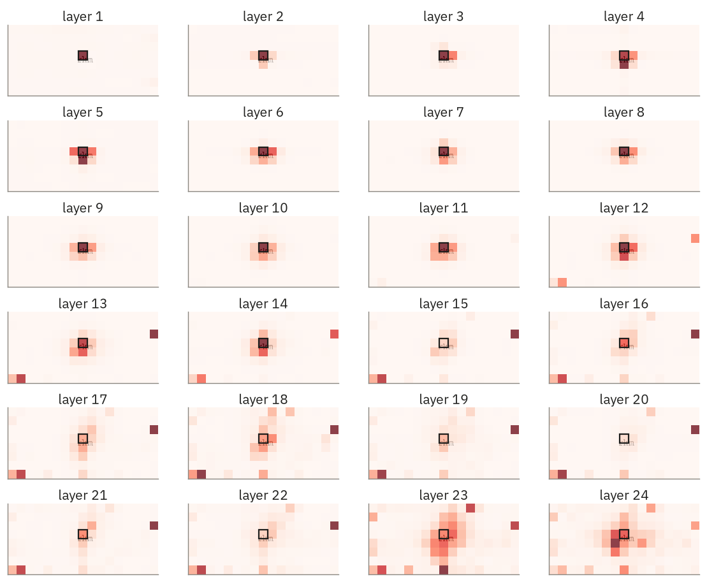
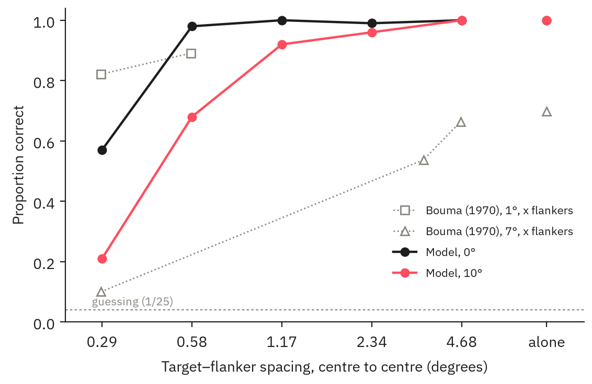
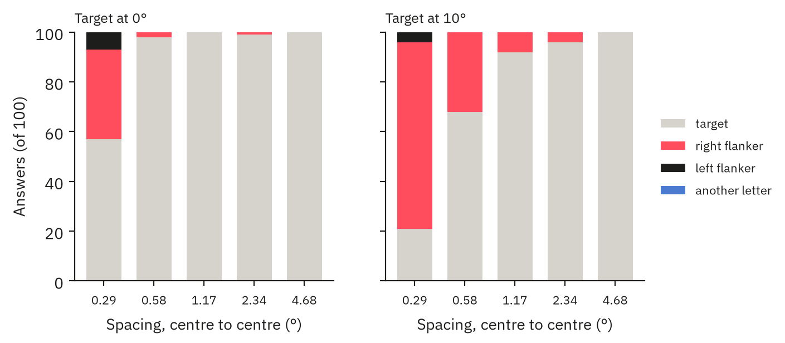
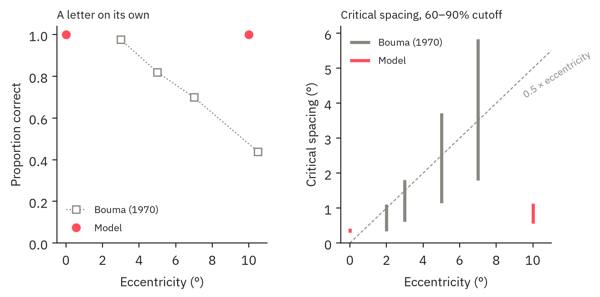

# Crowding

### What we will do here

1. What crowding is, and Bouma's simple spacing rule for it.
2. The original experiment: Bouma (1970) and his data.
3. The same task for a vision-language model.
4. How the model turns an image into numbers, step by step, with its real values.
5. What the model did.
6. The model next to Bouma's observers.
7. What it means.

### What is crowding?

An object (target) you can read when its isolated becomes very difficult to discriminate when surrounded by neighboring objects (flankers).  

**Figure 1.** Look at the cross. The N on the left is easy to name; the same N on the right, at the same distance, is lost between D and O.

## A surprisingly simple spacing rule: Bouma's window

Flankers hurt when they are closer than about half the eccentricity: Bouma's law. The critical spacing grows in a straight line with distance from fixation.

[demo: bouma]

**Figure 2.** Keep your eyes on the cross and move the slider. With the flankers close, the middle letter is hard to name; past about half the eccentricity (Bouma's window), it becomes easy. Click the image for new letters.

## The original experiment: Bouma (1970)

Here we use Bouma's own data from 1970, refitted with modern psychometric functions by Coates and colleagues (2021).

### Stimuli and the task

**Figure 3.** An example trial, drawn after Bouma (1970). The observer says the middle letter aloud.

Bouma's observer named the letter out loud. We ask the model the same question, "What was the middle letter?", but it must pick one of the 25 letters, even when guessing (a forced choice).

### Psychometric function fitting

Bouma tested each spacing about 100 times, at distances from 1° to 10.5° from fixation. Accuracy rises with spacing along an S-shaped curve, one curve per distance. The critical spacing is where a curve gets close to the accuracy for a letter on its own.

**Figure 4.** Bouma's data (dots) with fitted psychometric functions, one colour per distance from fixation. The further from fixation, the further right the curve: the letters must be further apart to be read. From Coates et al. (2021).

# Crowding in Vision Language Models

## Doing it with a VLM | The experiment

A VLM sees the whole image at the same resolution, so it may not crowd at all. We test this with one simple version of Bouma's experiment.

### The observer

The observer is Qwen3-VL-2B-Instruct, a small open vision-language model. It gets one image and one question and answers with text. We do not let it write freely. We read the score it gives to each of the 25 letters as its first word and take the highest one. So, like Bouma's observer, it always answers with a letter, and guessing gives 1 in 25 correct.

### The images

**Figure 5.** The images the model sees. Top: two whole images, with the target at the centre (0°) and at 10°. Bottom: the six conditions, cut around the target.

### The question

The same question for every image: "There is either one letter or a row of three letters. If there are three, name the middle one. If there is one, name it. Answer with a single lowercase letter."

### How the model sees the image

A VLM has two parts. A vision encoder turns the image into tokens, and a language model reads those tokens together with the words of the question. A token is the unit the model reads. Text is cut into word pieces; an image is cut into squares. In Qwen3-VL it goes like this:

**1. Cut.** The image is cut into squares of 16 × 16 pixels, about half a degree here.

**Figure 6a.** Our image around the target at 10°, with flankers one slot away, cut into the model's squares.

**2. Turn each square into numbers.** The model gets the pixel values of a square for red, green and blue, and twice over (the same code also reads video): one list of 1,536 numbers. A learned layer turns that list into 1,024 numbers that describe the square. Whatever is inside one square ends up in the same list: if parts of two letters fall into one square, they are described together.

**Figure 6b.** The shaded square, step by step, with the model's real numbers.

**3. Mix.** Every square looks at all the others and takes in some of what they hold, more from some than others. This happens once in each of the 24 layers. Afterwards, the numbers for the target's square also carry some of the flankers.

**Figure 6c.** Real values from the model, layer by layer. Red shows how much our square takes from each square (its attention, averaged over the model's 16 attention heads, each layer scaled to its own maximum). The strip is our square's 1,024 numbers after that layer.

**Figure 6d.** All 24 layers at once. Early on, our square looks mostly at itself and its close neighbours, including the r and the m. Later it looks further out, and in the last layers a few empty squares far away get a lot of attention. The numbers each square ends with, after layer 24, are what step 4 packs.

**4. Pack.** After the last layer, the squares are packed four at a time. Our square is square 4 of its token; square 3 holds a sliver of the r, and squares 1 and 2 are empty. The lists of each 2 × 2 block of squares are put end to end (4 × 1,024 numbers), and a small network turns them into one token of 2,048 numbers. A letter that lies across a token edge is split over two tokens, and a target and a close flanker can end up in the same one. Our image becomes 32 × 4 = 128 tokens.

**Figure 6e.** Our token, with the model's real numbers. It is token 58 of the 128.

**5. Read.** The 128 image tokens, our token 58 among them, are put in order, left to right and row by row, like lines of text. They go into the conversation between two marker tokens, before the question. Each word piece of the question also becomes 2,048 numbers, so the language model reads one row of 175 lists of numbers. The next word it writes is its answer.

**Figure 6f.** Everything the language model gets for our example image, in order, with the real numbers of every token. The bar at the bottom is the whole input; the box shows the part in view.

### Back to crowding: what the grid does to our letters

The grid decides which letters share a square, and which share a token, before any mixing happens. It does not care about distance from the centre: a letter's place on the grid depends only on its position in the image. Figure 7 shows three of our images. At the centre, token edges cut the target into four. At 10° with close flankers, the target and the left flanker share a token. With wider spacing, each letter has tokens of its own.

**Figure 7.** The token grid on our images. Top: the whole image, 32 × 4 tokens, the same grid at every position. Bottom: three close-ups, with tokens (solid lines) and the 16-pixel squares inside them (dotted); the tokens that hold the target are shaded.

This is very different from an eye. Human vision is sharp only at the centre, and the area over which features are pooled grows with distance from fixation, a common explanation for Bouma's rule (Balas et al., 2009). The model's grid is the same at 10° as at the centre. So if crowding came only from pooling that grows with distance, the model should crowd the same at 0° and at 10°.

### What we want to find out

1. Do close flankers make the model wrong?
2. Is the model worse at 10° than at 0°, as humans are?
3. When it is wrong, does it name a flanker?

## What the model did

A letter on its own was never a problem: 100 of 100 correct, at the centre and at 10°.

Close flankers hurt, and more at 10° than at the centre. At the centre only touching flankers mattered; at 10° the model needed about twice the space to read the target (Figure 8).

**Figure 8.** Proportion correct against target–flanker spacing. Each model point is 100 trials. In grey, Bouma's own data at the two eccentricities closest to ours, 1° and 7°, with "x" flankers. He did not test flanked letters at 0° or 10°.

Every wrong answer was a flanker: 169 of 169. Nearly always the one on the right: 119 of 123 times at 10°, and 39 of 46 times at the centre.

**Figure 9.** What the model answered at each spacing. Grey: the target. Red: the right flanker. Black: the left flanker. No answer was any other letter.

People also often name a flanker when crowded (Strasburger et al., 1991; Strasburger & Malania, 2013), but for them it is one kind of error among others. The model made no other kind. If it were guessing among the 24 wrong letters, only 2 in 24 errors (8%) would be flankers. So the model does not lose the target; it sees three letters and picks the wrong one, nearly always the right one.

## Model versus humans

**Figure 10.** The model (red) next to Bouma's data (grey). Left: a letter on its own. Right: critical spacing; each bar runs from the 60% to the 90% cutoff. The dashed line is Bouma's rule, half the eccentricity. Bouma's bars are our refit of his data, as extracted from Coates et al. (2021).

**Like humans.** Close flankers hurt, more so away from the centre, and the wrong answer is a flanker (Bouma, 1970).

**Unlike humans.**

1. **A single letter never got harder.** Bouma's observer got worse further out; the model read every letter, even at 10°.
2. **A much smaller crowding zone.** At 10° the model crowds about as much as a person does at 2° to 3° (Figure 10).
3. **A different kind of error.** People also name letters that were not shown; the model always named one of the three (Figure 9). It seems to recognise the letters and fail at picking the middle one.

**Not the grid.** The grid is the same at 0° and 10°, yet the model crowds more at 10°. And it named the right flanker even when the left one shared the target's token (Figure 7).

## What it means

The model crowds, but only a little. It shows some of the human signs: close flankers hurt, the wrong answer is a flanker, and it gets worse away from the centre. But its window is several times smaller than a human's at the same place, and a single letter is never lost.

We do not know yet why the model is worse at 10° than at the centre. Its grid is the same everywhere, so it is not about sharpness. It may be that the centre of the image is special to the model, rather than distance itself.

Two next steps. First, more positions on both sides of the centre. This would show whether the window really grows with distance, and would separate "outer" from "right". Second, give the model a human-like periphery before it sees the image (Deza et al., 2019), and see if its window grows to Bouma's size.

### References

- Balas, B., Nakano, L., & Rosenholtz, R. (2009). A summary-statistic representation in peripheral vision explains visual crowding. *Journal of Vision*, 9(12):13, 1–18.
- Bouma, H. (1970). Interaction effects in parafoveal letter recognition. *Nature*, 226, 177–178.
- Coates, D. R., Ludowici, C. J. H., & Chung, S. T. L. (2021). The generality of the critical spacing for crowded optotypes: From Bouma to the 21st century. *Journal of Vision*, 21(11):18, 1–22.
- Deza, A., Jonnalagadda, A., & Eckstein, M. P. (2019). Towards metamerism via foveated style transfer. *ICLR*.
- Strasburger, H., Harvey, L. O., Jr., & Rentschler, I. (1991). Contrast thresholds for identification of numeric characters in direct and eccentric view. *Perception & Psychophysics*, 49(6), 495–508.
- Strasburger, H., & Malania, M. (2013). Source confusion is a major cause of crowding. *Journal of Vision*, 13(1):24.
