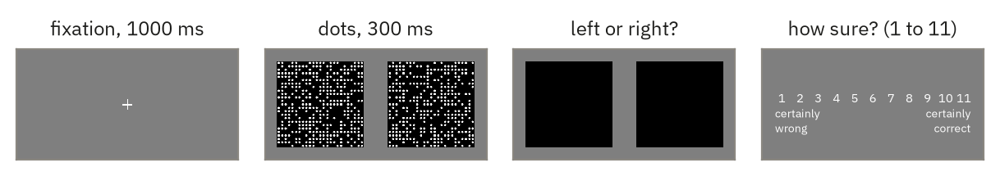
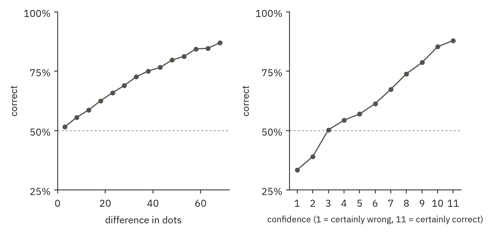
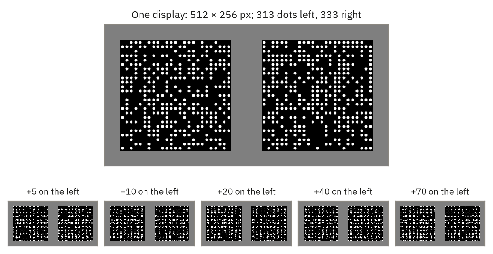
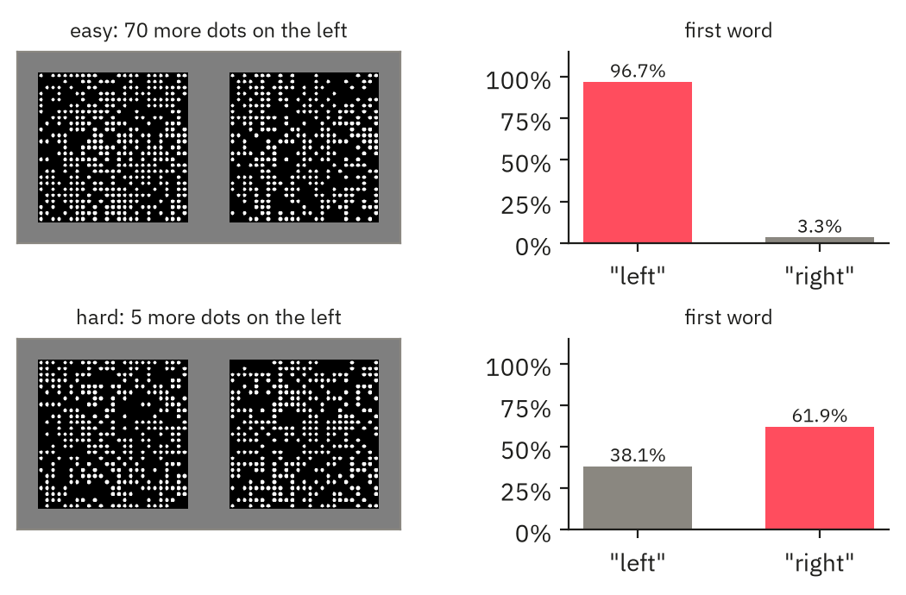
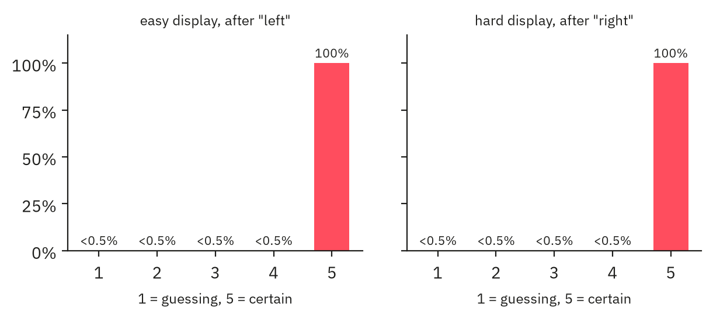
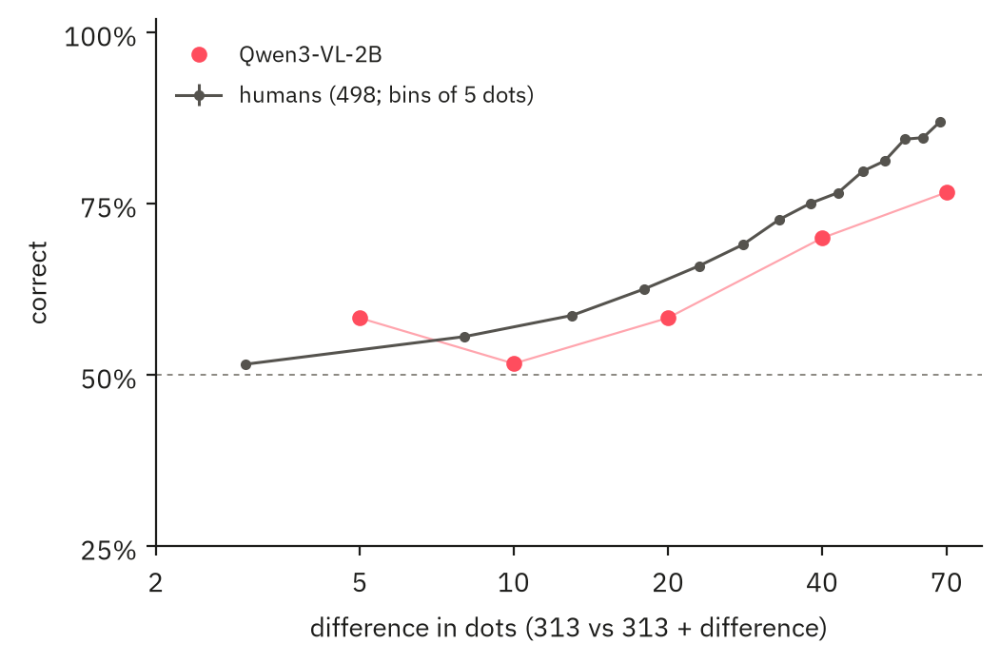
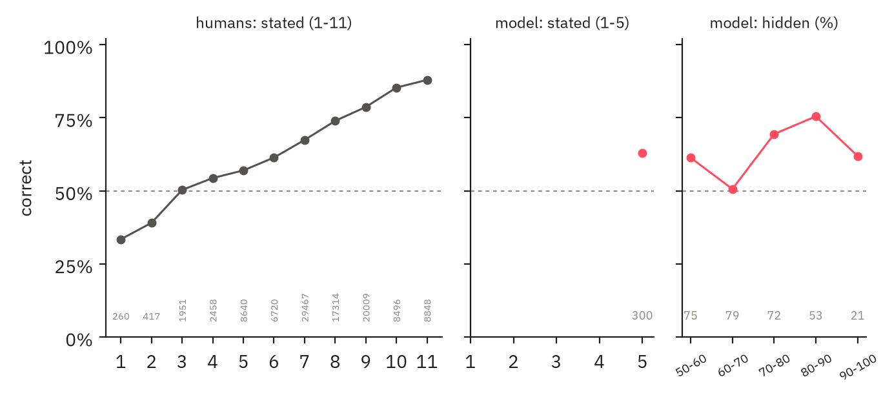

# Metacognition

### What we will do here

1. A dots task with confidence ratings (Rouault et al., 2018) and its human data.
2. The same task with a vision-language model.
3. Two kinds of confidence in the model.
4. What the model did.
5. The model next to humans.
6. What it means.

## The dots task: Rouault et al. (2018) | The dots task

Two black boxes with white dots were shown for 300 ms. One box always had 313 dots, the other had 1 to 70 more. People said which box had more dots, then rated their confidence from 1 (certainly wrong) to 11 (certainly correct). Each person did 210 trials online, without feedback.

**Figure 1.** One trial, drawn from the paper's description.

The measure is the area under the type 2 ROC curve (Aroc). It is the chance that a correct answer got a higher confidence rating than an incorrect one. 0.5 means confidence tells nothing about being correct, 1 means it tells it perfectly.

## Human results

We use the data of experiment 1, 498 people, from the Confidence Database (Rahnev et al., 2020).

A bigger difference made the task easier. And when people were more confident, they were more often correct.

**Figure 2.** Left: proportion correct by the difference in dots (mean of 498 people). Right: proportion correct at each confidence rating. Data: Rouault et al. (2018).

Their Aroc (our calculation) has a median of 0.65. So people know, at least partly, when they are right.

# Metacognition in Vision Language Models

## Doing it with a VLM | The experiment

Now Qwen3-VL-2B does the same task. It sees both boxes in one image and gets two questions in the same chat:

1. "Which box has more dots: left or right? Answer with one word."
2. "How sure are you that your answer is correct? Answer with one number from 1 (guessing) to 5 (certain)."

One box has 313 dots, the other 5, 10, 20, 40 or 70 more. For each difference there are 30 images, and each is shown twice: as it is, and with the boxes swapped. We swap them because the model likes to say "left" (see the contrast sensitivity chapter).

**Figure 3.** One image as the model sees it (top), and one image for each difference (bottom).

### Two kinds of confidence

**Hidden confidence.** Before writing its answer, the model gives a probability to every possible first word. We take the probability of its answer, out of "left" and "right". It goes from 50% (a coin flip) to 100%.

**Figure 4a.** An easy and a hard display, and the model's probabilities for its first word. Red: its answer. On the hard display it was wrong, with 62%.

**Stated confidence.** The model's answer stays in the chat, and we ask how sure it is. We take the digit it is most likely to write.

**Figure 4b.** The same two displays: the model's probabilities for the digits 1 to 5, after its answer.

Both times it says 5, "certain", also after the wrong answer.

## What the model did

With a bigger difference the model was more often correct, from about guessing at 5 and 10 dots to three out of four at 70 dots.

**Figure 5.** Proportion correct by the difference in dots. Red: Qwen3-VL-2B, 60 displays per point. Grey: humans (mean of 498 people, bins of 5 dots). Dashed line: guessing (50%).

The model said "left" on 221 of the 300 displays. So it was mostly correct when the left box had more dots (87%), and mostly wrong when the right box had (39%).

Its stated confidence was 5 on all 300 displays.

## Model versus humans

**Figure 6.** Proportion correct at each confidence level. Left: humans, 1 to 11 (all trials of the 498 people). Middle: the model's stated confidence. Right: the model's hidden confidence, in bins. Small numbers: trials per point. Dashed line: guessing (50%).

### Like humans

1. **Easier with more dots.** Both get better as the difference grows, and both are close to guessing at the smallest differences.

### Unlike humans

1. **Always certain.** When asked, the model always says 5. Its stated confidence tells nothing about being correct (Aroc 0.5). Humans use the whole scale.
2. **A weak hidden confidence.** The hidden confidence was a little higher on correct answers. Its Aroc is 0.57, below 89% of the people. With 300 displays it is uncertain (95% interval 0.50 to 0.63).
3. **No steady rise.** For humans, a higher rating means more often correct. For the model's hidden confidence, it goes up and down.

## What it means

The model did the perceptual part of the task close to humans, a little less accurately (Figure 5). It failed the part about its own decision. So a model can see the dots almost as well as people and still not know when it is wrong.

The model's probabilities may carry a weak signal of being correct, but its words do not report it. Asked how sure it is, it says "certain" every time.

In humans, uncertainty is part of seeing. The brain is noisy, so the same display does not always look the same, and a hard display feels uncertain. The model has no such noise. The same image always gives the same answer (see the contrast sensitivity chapter), so nothing forces it to represent how unsure it is.

An open question is how uncertainty can emerge in these models, so that their confidence follows their accuracy as it does in humans.

### References

- Rahnev, D., Desender, K., Lee, A. L. F., et al. (2020). The Confidence Database. *Nature Human Behaviour*, 4, 317–325.
- Rouault, M., Seow, T., Gillan, C. M., & Fleming, S. M. (2018). Psychiatric symptom dimensions are associated with dissociable shifts in metacognition but not task performance. *Biological Psychiatry*, 84, 443–451.
