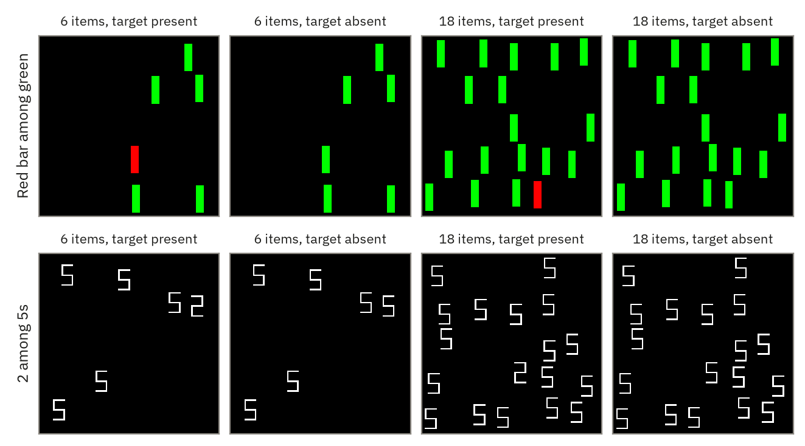
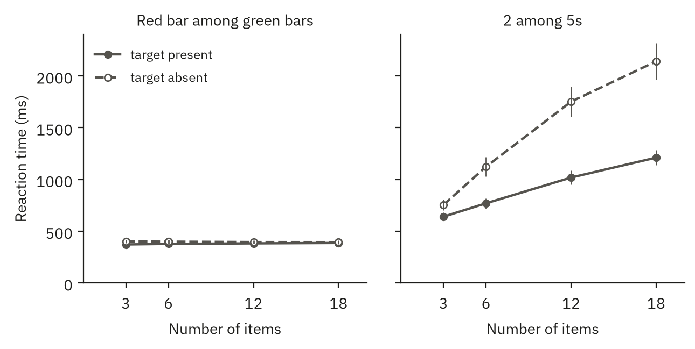
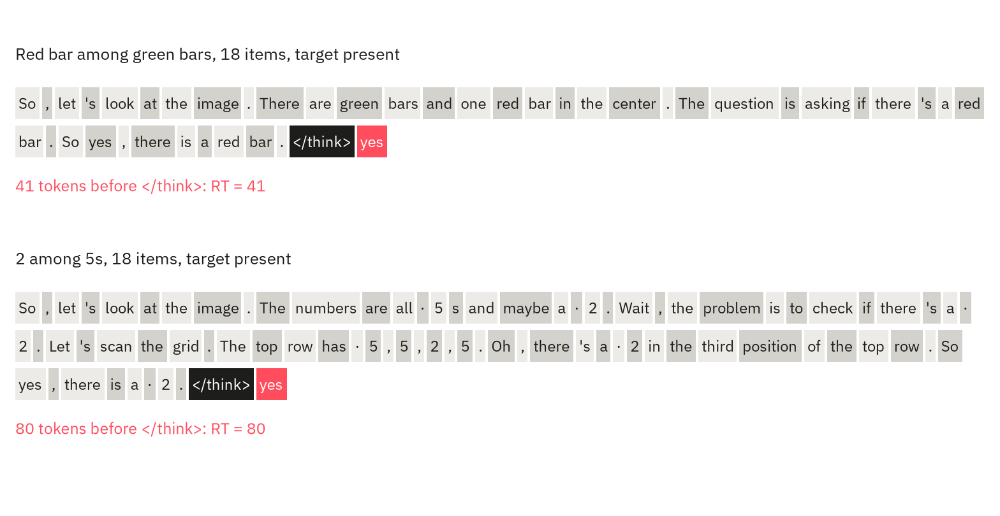
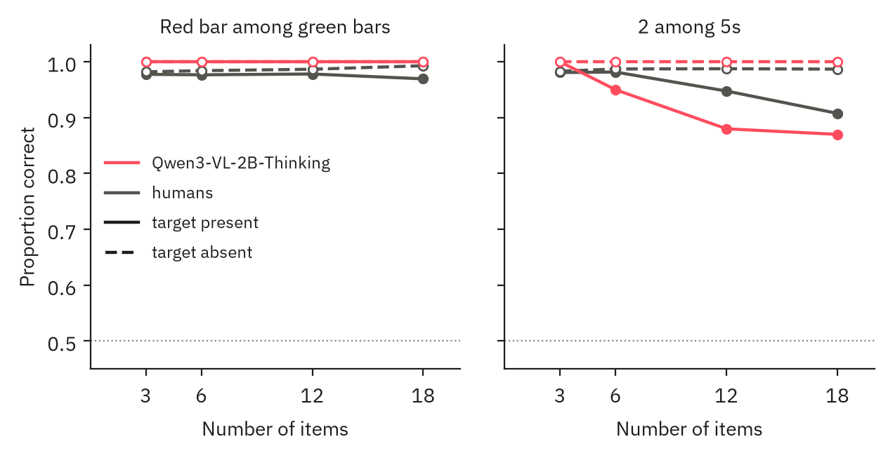
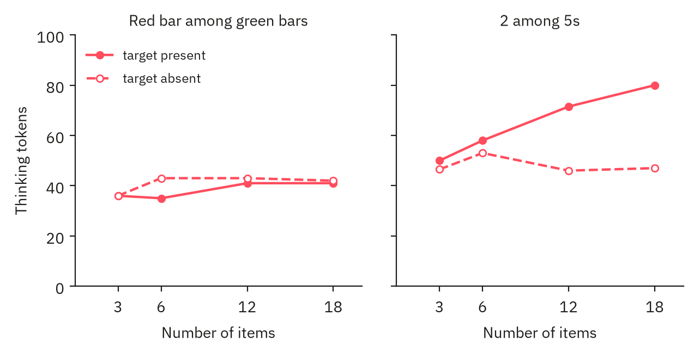

# Visual search

### What we will do here

1. Visual search (Treisman & Gelade, 1980) and the human data of Wolfe, Palmer & Horowitz (2010).
2. The same task with a vision-language model.
3. A reaction time for a model: its thinking tokens.
4. What the model did.
5. The model next to humans.
6. What it means.

## Visual search: Treisman & Gelade (1980) | Visual search

In visual search, observers look for a target among distractors and report, as fast as they can, whether it is present. The measure is how reaction time (RT) grows with the number of items (set size): the search slope, in ms per item.

Treisman and Gelade (1980) described two kinds of search. A target that differs by a single feature, such as colour, pops out: RT does not depend on set size. A target defined by a conjunction of features takes longer with each item added. In their feature integration theory, features are registered in parallel across the display, while binding them into an object needs attention, deployed to one item at a time.

Wolfe, Palmer and Horowitz (2010) collected about 4000 trials per observer on standard search tasks and made the data public. We use two of them: a red bar among green bars (feature search) and a digital 2 among digital 5s (spatial configuration search). The 2 and the 5 have the same strokes in a mirrored arrangement, so no single feature separates them.

**Figure 1.** The two tasks at set sizes 6 and 18, with and without the target. Drawn after Wolfe et al.: black background, each item at a random position within a cell of an invisible 5 × 5 grid.

Set size was 3, 6, 12 or 18, and the target was present on half of the trials. The display stayed on until the response.

## Human results

**Figure 2.** RT of correct trials against set size (mean of 9 observers, ± 1 SE). Solid: target present. Dashed: target absent. Data: Wolfe et al. (2010).

The red bar search was efficient, about 1 ms per item. For the 2 among 5s the slope was 43 ms per item on target-present trials and 95 ms per item on target-absent trials, a ratio of about 2:1.

This ratio is what a serial self-terminating search predicts. A present target is found on average halfway through the items; an absent one requires checking them all. Wolfe et al. treat "serial" as a theoretical claim and call such searches inefficient instead.

Errors were rare. Most were misses in the 2 among 5s task, rising to 9% at set size 18.

# Visual Search in Vision Language Models

## Doing it with a VLM | The experiment

The observer is Qwen3-VL-2B-Thinking, the reasoning version of the model used in the other chapters. Each display (Figure 1) comes with one question:

1. "Is there a red bar in the image? Answer yes or no."
2. "Is there a 2 in the image? Answer yes or no."

Item sizes follow Wolfe et al. in degrees of visual angle, at 32 pixels per degree as in the crowding chapter (bars 1 × 3.5°, digits 1.5 × 2.7°). Each set size has 100 layouts, each shown once with the target and once with a distractor in its place: 1600 displays.

An earlier wording, "Is there a 2 among the 5s?", failed. The model often reported the 2 in its reasoning and then answered no, because "the 2 is not among the 5s".

### Thinking time as reaction time

Language models are autoregressive. They generate one token (a word or part of a word) at a time, and each token takes one forward pass through the network, a nearly fixed amount of computation.

The image is encoded once, in parallel, at the start. Its cost is the same for every display, so clock time carries no information about the search. It depends only on the hardware and the number of generated tokens.

A thinking model first generates its reasoning, ends it with a special token, </think>, and then gives its answer. The model itself decides when to stop. We take the number of tokens before </think> as its RT: the number of computation steps spent before responding.

**Figure 3.** Two replies split into the model's tokens. Each box is one token, one forward pass. Red: the answer.

Each generated token is fed back as input to the following steps, so the reasoning acts as a working memory. It is the only place where the model can go back over the display item by item. In the second reply, it reads the top row and finds the 2.

de Varda et al. (2025) used the same measure and found that problems requiring more reasoning tokens from models also took people longer.

Replies are sampled, so the token count varies across repetitions of the same display, as human RT does.

## What the model did

Accuracy was perfect for the red bar. In the 2 among 5s task, misses increased with set size, up to 13% at 18 items. There were no false alarms.

**Figure 4.** Proportion correct against set size. Red: Qwen3-VL-2B-Thinking (100 displays per point). Grey: humans (all trials of 9 observers). Solid: target present. Dashed: target absent. Dotted line: chance.

For the red bar, the model used about 40 tokens at every set size. For the 2 among 5s, the count rose with set size on target-present trials, about 2 tokens per item, and stayed near 47 tokens on target-absent trials.

**Figure 5.** Thinking tokens of correct replies against set size (median). Solid: target present. Dashed: target absent.

A few replies ran to hundreds or thousands of tokens (at most 2793). In these the model loses track and lists the same rows repeatedly ("Row 1: 5 5 5. Row 2: 5 5 5. Wait, no…").

Misses were slightly more frequent when a 5 was close to the 2, as in crowding, but such displays were few.

## Model versus humans

Figures 2 and 5 are in different units, milliseconds and tokens, so we compare the shape of the functions.

### Like humans

1. **Efficient feature search.** For the red bar, neither RT nor token count depends on set size.
2. **A positive slope for a present 2.** Both take longer as set size grows.
3. **Misses, few false alarms.** Both miss more 2s in large displays and rarely report an absent 2.

### Unlike humans

1. **No slope on absent trials.** For people the absent slope is about twice the present slope. The model uses the same number of tokens at 3 and at 18 items.
2. **More misses.** At 12 and 18 items the model missed more 2s than people.

## What it means

The model's token count behaves like a search time only on target-present trials, where it grows with set size and the reply locates the 2.

On target-absent trials the model does not search exhaustively. After a first look it writes "all the numbers are 5s" and answers, while people keep searching until they are fairly sure the target is absent. This early stopping probably also explains the extra misses: a 2 not detected in the first pass is never searched for.

Part of the extra cost on present trials may come from describing where the 2 is ("the top row has 5, 5, 2, 5"). The reasoning text is the model's own account of the process and may not reflect the computation behind it.

The model's "no" is decided by its single parallel pass over the image, and the reasoning adds little. Whether a model can learn to search serially, checking items until it is confident, remains open.

### References

- de Varda, A. G., et al. (2025). The cost of thinking is similar between large reasoning models and humans. *Proceedings of the National Academy of Sciences*. doi:10.1073/pnas.2520077122
- Treisman, A. M., & Gelade, G. (1980). A feature-integration theory of attention. *Cognitive Psychology*, 12, 97–136.
- Wolfe, J. M., Palmer, E. M., & Horowitz, T. S. (2010). Reaction time distributions constrain models of visual search. *Vision Research*, 50, 1304–1311.
